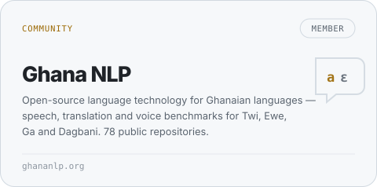

<picture>
  <source media="(prefers-color-scheme: dark)" srcset="assets/terminal-dark.svg">
  
</picture>

hi, I'm Richard.

I'm a technical founder in Accra. I build **[Typeres](https://typeres.com)** — print ordering that runs from artwork to delivery — and I co-founded **[AiMlCamp](https://github.com/aimlcamp)**, a community of AI/ML builders in Ghana. I'm also in **[Ghana NLP](https://github.com/ghananlp)**, working on open language technology for Twi, Ewe, Ga and Dagbani.

Most of what I ship lives behind a login where nobody can see it, so this page is the receipt: what exists, what it does, and what I haven't proven yet.

**[typeres.com](https://typeres.com)** &nbsp;·&nbsp; **[LinkedIn](https://www.linkedin.com/in/theniilante/)** &nbsp;·&nbsp; **[Codementor](https://www.codementor.io/@richardniilantelawson)**

 

<a href="https://typeres.com">
  <picture>
    <source media="(prefers-color-scheme: dark)" srcset="assets/typeres-dark.svg">
    
  </picture>
</a>

Getting flyers, shirts or banners printed in Ghana usually means artwork over WhatsApp, prices over the phone, and hoping the job that comes back is the job you asked for.
Typeres turns that into a pipeline: upload artwork, get a price, pick a verified vendor, then watch the job move through **brief → proof → payment held → delivery**, with the file, the approval and the courier attached to the same order.
It's the product my own engineering rules get applied to first. **[typeres.com](https://typeres.com)**

 

### Community work

  <a href="https://github.com/ghananlp"><picture>
    <source media="(prefers-color-scheme: dark)" srcset="assets/tile-ghananlp-dark.svg">
    
  </picture></a>
  <a href="https://github.com/aimlcamp"><picture>
    <source media="(prefers-color-scheme: dark)" srcset="assets/tile-aimlcamp-dark.svg">
    
  </picture></a>

 

### How the work gets checked

I don't trust a green test run I haven't watched fail first. Every piece of work I run ends with a numbered ticket, a stated verdict and an explicit list of what was **not** verified — on a client's system exactly as on my own product. It is slower, and it's the only way I can say "done" without guessing.

<picture>
  <source media="(prefers-color-scheme: dark)" srcset="assets/rules-dark.svg">
  
</picture>

 

### What I actually reach for

Laravel and Livewire do most of the work. Everything else shows up when the job needs it, not because it was new that month.

<picture>
  <source media="(prefers-color-scheme: dark)" srcset="assets/stack-dark.svg">
  
</picture>

 

### This year, itemised

Nearly every contribution I make lands in a private repository — a product, its tests, its tickets. The public commit count has never been the interesting number.

  <picture>
    <source media="(prefers-color-scheme: dark)" srcset="assets/receipt-dark.svg">
    
  </picture>

---

Accra, Ghana · GMT · every graphic here is a hand-drawn SVG, drawn and refreshed by [one Node script](scripts/generate.mjs) with no dependencies.
