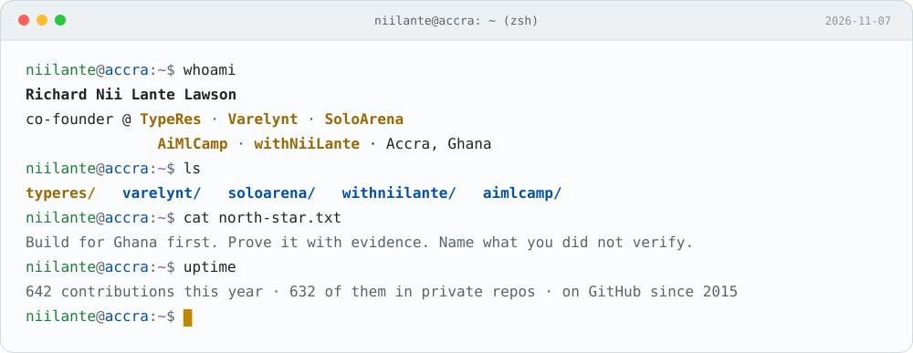
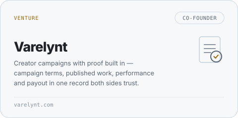
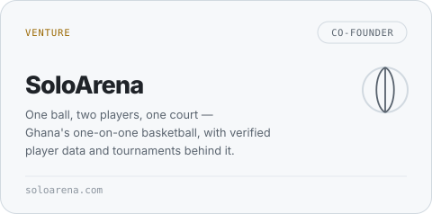
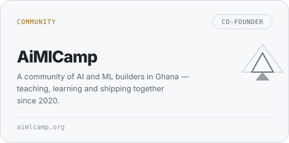
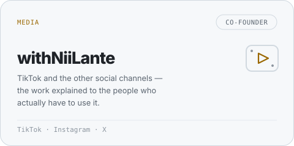
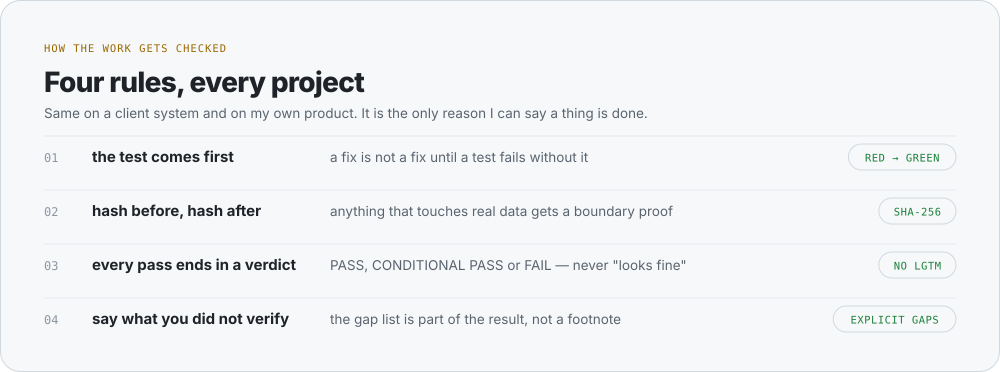
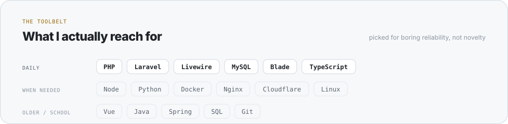
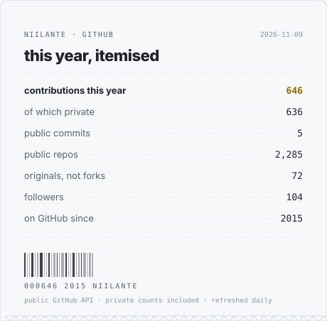

<picture>
  <source media="(prefers-color-scheme: dark)" srcset="assets/terminal-dark.svg">
  
</picture>

hi, I'm Richard.

I'm a technical founder in Accra, and a co-founder of **[TypeRes](https://typeres.com)**, **[Varelynt](https://varelynt.com)**, **[SoloArena](https://soloarena.com)**, **AiMlCamp** and **withNiiLante**. I'm also in **[Ghana NLP](https://github.com/ghananlp)**, on open language technology for Twi, Ewe, Ga and Dagbani.

Most of what I ship lives behind a login where nobody can see it, so this page is the receipt: what exists, what it does, and what I haven't proven yet.

**[typeres.com](https://typeres.com)** &nbsp;·&nbsp; **[LinkedIn](https://www.linkedin.com/in/theniilante/)** &nbsp;·&nbsp; **[Codementor](https://www.codementor.io/@richardniilantelawson)**

 

<a href="https://typeres.com">
  <picture>
    <source media="(prefers-color-scheme: dark)" srcset="assets/typeres-dark.svg">
    
  </picture>
</a>

TypeRes is the one I'm closest to: **Ghana's marketplace for event, print and business essentials**. Three collections — **Events**, **Print & Brand**, **Business** — because the same person buying canopies for a wedding is buying shirts for a team and bottles for a shop, and in Ghana that usually means three different WhatsApp threads and three different prices.
The marketplace is built. The pilot is Kumasi. Everything below is what I insist on before it goes live. **[typeres.com](https://typeres.com)**

 

### The other things I co-founded

  <a href="https://varelynt.com"><picture>
    <source media="(prefers-color-scheme: dark)" srcset="assets/tile-varelynt-dark.svg">
    
  </picture></a>
  <a href="https://soloarena.com"><picture>
    <source media="(prefers-color-scheme: dark)" srcset="assets/tile-soloarena-dark.svg">
    
  </picture></a>

  <a href="https://github.com/aimlcamp"><picture>
    <source media="(prefers-color-scheme: dark)" srcset="assets/tile-aimlcamp-dark.svg">
    
  </picture></a>
  <picture>
    <source media="(prefers-color-scheme: dark)" srcset="assets/tile-withniilante-dark.svg">
    
  </picture>

 

### How the work gets checked

I don't trust a green test run I haven't watched fail first. Every piece of work I run ends with a numbered ticket, a stated verdict and an explicit list of what was **not** verified — on a client's system exactly as on my own product. It is slower, and it's the only way I can say "done" without guessing.

<picture>
  <source media="(prefers-color-scheme: dark)" srcset="assets/rules-dark.svg">
  
</picture>

 

### What I actually reach for

Laravel and Livewire do most of the work. Everything else shows up when the job needs it, not because it was new that month.

<picture>
  <source media="(prefers-color-scheme: dark)" srcset="assets/stack-dark.svg">
  
</picture>

 

### This year, itemised

Nearly every contribution I make lands in a private repository — a product, its tests, its tickets, five ventures. The public commit count has never been the interesting number.

  <picture>
    <source media="(prefers-color-scheme: dark)" srcset="assets/receipt-dark.svg">
    
  </picture>

---

Accra, Ghana · GMT · every graphic here is a hand-drawn SVG, drawn and refreshed by [one Node script](scripts/generate.mjs) with no dependencies.
